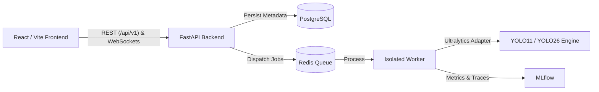

# AI Vision Trainer

[](https://github.com/your-org/ai-vision-trainer/actions/workflows/ci.yml)
[](LICENSE)
[](https://www.python.org/)
[](https://react.dev/)

**AI Vision Trainer** is a production-grade, self-hosted web platform for supervised YOLO object detection training, evaluation, dataset curation, experiment tracking, and GPU/edge deployment.

---

## Architecture Overview

AI Vision Trainer decouples user interaction and API serving from intensive ML model execution:
- **Frontend**: React 18+ (Vite) with JavaScript, Tailwind CSS, shadcn/ui patterns, and Framer Motion.
- **Backend**: FastAPI (Python 3.11+), Pydantic v2, SQLAlchemy 2.0, PostgreSQL, and Redis.
- **Workers**: Decoupled background workers orchestrating Ultralytics YOLO (supporting YOLO11 and YOLO26 detection models).
- **Zero-GPU CPU Bootstrap**: First functional vertical slice and full test suites run on CPU without requiring GPU hardware.
- **Truthful Telemetry**: Real hardware readings, loss curves, and evaluation metrics queried from system sensors without fabricated synthetic data.



---

## Monorepo Layout

```
ai-vision-trainer/
├── frontend/             # React/Vite JavaScript application
│   ├── src/
│   │   ├── api/          # Typed API clients & WebSocket managers
│   │   ├── components/   # UI components
│   │   └── test/         # Vitest test setup and test specs
├── backend/              # FastAPI Python backend application
│   ├── app/
│   │   ├── api/          # Versioned REST endpoints (/api/v1/...)
│   │   ├── core/         # Config, logging, security, database session
│   │   ├── models/       # SQLAlchemy ORM models
│   │   ├── schemas/      # Pydantic v2 schemas
│   │   └── services/     # Business logic & repository services
│   ├── alembic/          # Database migrations
│   └── tests/            # Pytest test suite (unit, integration, security)
├── worker/               # Background task workers (isolated training/eval)
│   ├── adapters/         # Model execution adapters (Ultralytics YOLO)
│   └── tasks/            # Job runners
├── shared/               # Shared constants, contracts, and schema definitions
├── infrastructure/       # Dockerfile, docker-compose.yml, Nginx configs
├── docs/                 # Architecture, ADRs, user guides
├── tests/                # Monorepo cross-cutting fixtures
├── Makefile              # Development command automation
├── .env.example          # Environment variable reference
└── AGENTS.md             # Phase tracking ledger & operational manual
```

---

## Quick Start & Local Development

### 1. Prerequisites
- Python 3.11+
- Node.js 20+ & npm
- PostgreSQL & Redis (or Docker Compose)

### 2. Setup Environment
```bash
cp .env.example .env
```

### 3. Install Dependencies
```bash
# Install backend dependencies
python3 -m pip install -r backend/requirements.txt

# Install frontend dependencies
cd frontend && npm install && cd ..
```

### 4. Run Automated Tests
```bash
# Run all tests (backend, worker, frontend, monorepo)
make test
```

### 5. Start Backend and Frontend
In terminal 1:
```bash
make dev-backend
# API running at http://localhost:8000 (Docs: http://localhost:8000/docs)
```

In terminal 2:
```bash
make dev-frontend
# Web UI running at http://localhost:5173
```

---

## Docker Compose Quickstart
To launch the complete containerized stack (PostgreSQL, Redis, Backend, Frontend with Nginx):
```bash
make docker-up
```
Access the application at `http://localhost`.

---

## Licensing Gate
The core platform code is licensed under **Apache License 2.0**. Third-party ML framework integrations (Ultralytics YOLO) are subject to GNU AGPL v3.0 or an Enterprise Commercial License from Ultralytics LLC. See [LICENSE](LICENSE) and [ADR 0001](docs/adr/0001-licensing-and-ultralytics.md) for full compliance details.
