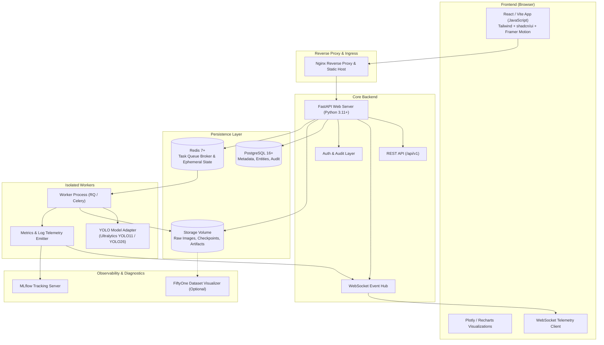

# AI Vision Trainer — System Architecture

## 1. System Overview
**AI Vision Trainer** is a self-hosted, production-grade web platform for training, evaluating, curating, tracking, and deploying YOLO object detection models. The platform prioritizes:
- **Asynchronous Execution**: Training and evaluations run strictly in dedicated worker processes, never blocking the web server.
- **Data & Model Provenance**: Complete reproducibility from immutable raw images, annotation revisions, dataset snapshots, hyperparameter configurations, random seeds, and environment metadata down to trained weights and benchmark artifacts.
- **Truthful Telemetry**: Real, un-fabricated telemetry originating from verified hardware sensors and actual Ultralytics training/evaluation loops.
- **Untrusted File Hardening**: Strict MIME checks, magic-byte inspection, path traversal neutralization, archive bomb limits, and isolated processing for all user uploads.
- **Zero-GPU CPU Bootstrap**: CPU-first vertical slice capability so developers can develop, test, and run full test suites without dedicated GPU hardware.

---

## 2. High-Level Architecture Diagram

---

## 3. Core Subsystems and Responsibilities

### 3.1 Frontend (`frontend/`)
- Built with **React 18+**, **Vite**, and **JavaScript**.
- Styling with **Tailwind CSS**, designed dark-first with accessible high-contrast accents and smooth motion animations.
- Connects to `/api/v1` backend endpoints with typed response validation and optimistic UI updates.
- Real-time event consumption via WebSockets for training loss curves, resource usage, and job progress.

### 3.2 Backend API (`backend/`)
- Built with **FastAPI** on Python 3.11+.
- **Pydantic v2** for strictly validated request/response DTOs.
- **SQLAlchemy 2.0** ORM coupled with **Alembic** for explicit, tracked database schema migrations.
- Structured JSON logging with trace IDs propagating across requests and queued jobs.
- Secure upload ingestion: chunked/resumable upload handler, archive extraction sanitizer, and secure static serving.

### 3.3 Worker Engine (`worker/`)
- Decoupled worker processes communicating with Redis.
- Model adapters isolating third-party training engines (specifically Ultralytics YOLO).
- Graceful termination handling: intercepts SIGINT/SIGTERM, preserves intermediate checkpoints, marks job status as cancelled/failed gracefully.
- Emits real-time training step progress, GPU/CPU memory metrics, and mAP evaluation figures directly to Redis pub/sub.

### 3.4 Data & Model Provenance
Every trained model checkpoint is permanently linked to:
1. Exact dataset snapshot version hash (SHA-256).
2. Model base architecture (e.g., `yolo11n.pt`, `yolo26s.pt`).
3. Complete hyperparameter dictionary (epochs, batch size, optimizer, lr, augmentations).
4. System environment fingerprint (Python version, PyTorch version, CUDA version, OS, git commit SHA).
5. Deterministic random seed.

---

## 4. Security & Safety Model
- **Untrusted File Validation**: File uploads check MIME headers, file signatures (magic bytes), and reject executable or nested zip-bomb structures.
- **Path Sanitization**: User-supplied filenames are normalized; directory traversal attempts (`../`) are strictly blocked.
- **No Command Concatenation**: Workers execute tasks via programmatic Python APIs (Ultralytics Python SDK), never by formatting user strings into raw shell commands.
- **Audit Logging**: All state-modifying actions (dataset creation, deletion, training start, configuration edits) record an immutable audit log entry.
